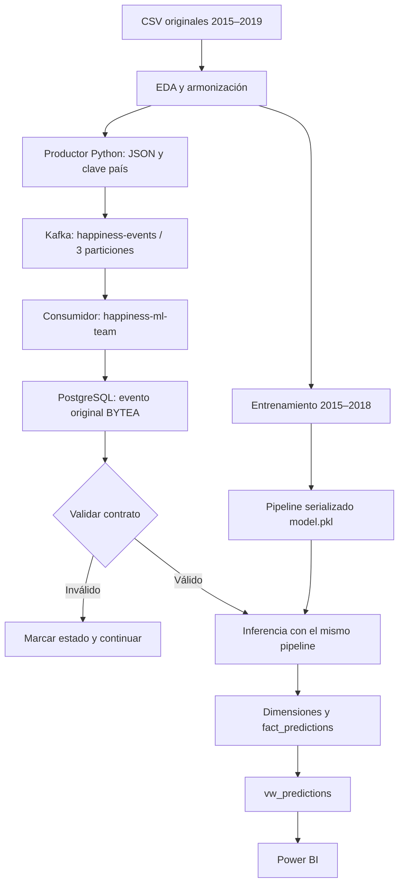
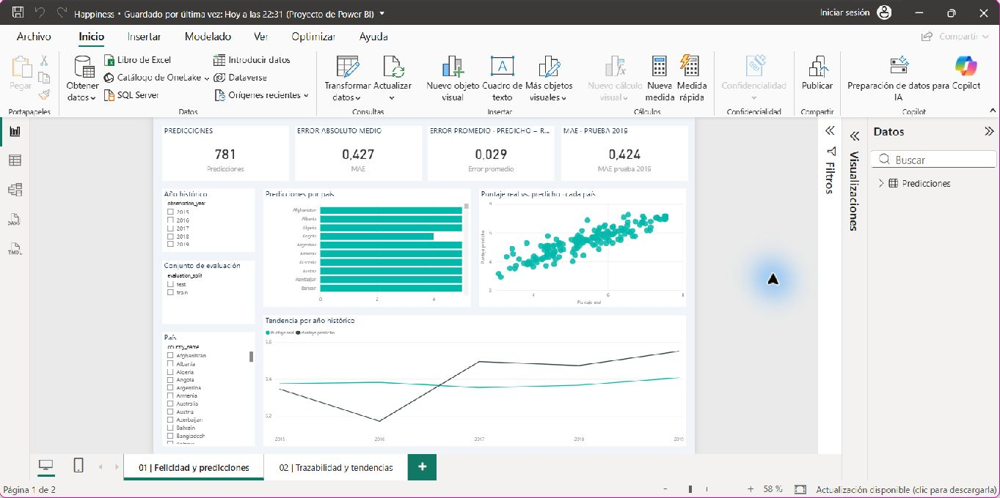
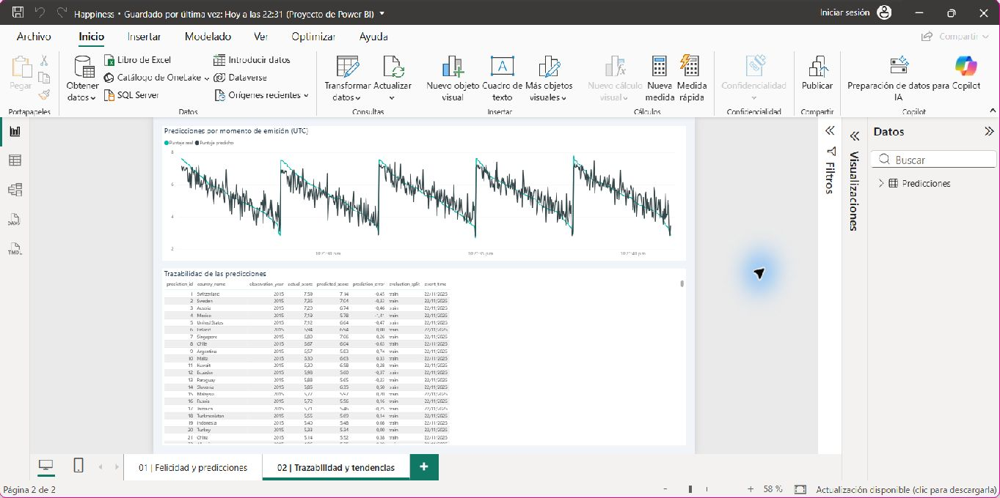

# Workshop 3 — Streaming ETL y predicción de felicidad

Pipeline de Python, Apache Kafka y PostgreSQL que simula la llegada de observaciones históricas de World Happiness Report (2015–2019), valida los eventos y predice el puntaje de felicidad. Power BI consulta la base de datos para analizar las predicciones.

## Arquitectura



Los CSV son fuentes finitas: el productor publica una fila a la vez con una pausa configurable. El año histórico y el momento de emisión tienen significados diferentes. No se trata de mediciones nuevas del mundo real.

## Entregables

| Ruta | Contenido |
|---|---|
| `notebooks/eda.ipynb` | EDA ejecutado, nulos, duplicados, tipos, diferencias, extremos y correlaciones |
| `notebooks/model_training.ipynb` | Entrenamiento ejecutado, baseline, métricas y gráficas |
| `data/raw/` | Cinco CSV proporcionados con el taller |
| `data/processed/happiness.csv` | Fuente armonizada, conservando el faltante original |
| `models/model.pkl` | Imputación, escalado y regresión en un único Pipeline |
| `models/metadata.json` | Features, años, métricas, versión y hash del modelo |
| `kafka/producer.py`, `kafka/consumer.py` | Streaming, validación, persistencia y predicción |
| `sql/` | Esquema y consultas KPI |
| `dashboards/Happiness.pbip` | Proyecto editable de Power BI y modelo con origen PostgreSQL |
| `reports/pipeline_verification.json` | Resultado de la prueba real del pipeline |
| `tests/` | Contrato, preservación de bytes, reentregas y errores de predicción |
| `docs/sustentacion.md` | Guía para explicar y demostrar el proyecto |

## Datos y decisiones de limpieza

Hay 782 filas: 158 (2015), 157 (2016), 155 (2017), 156 (2018) y 156 (2019). No se encontraron filas idénticas dentro de cada fuente. Se verificó la unicidad país/año después de armonizar.

El esquema común es `country`, `year`, `gdp`, `family`, `health`, `freedom`, `generosity`, `corruption` y `happiness_score`. Los alias están centralizados en `src/data.py`. Se recortan espacios y se unifican las variantes explícitas de Taiwan y Hong Kong. Family y Social support se agrupan como `family`; el cambio entre ediciones limita su comparabilidad.

Se conserva el único faltante de corrupción en 2018. Para entrenar, `SimpleImputer` aprende la mediana únicamente con 2015–2018. En streaming se envía `null`, se conserva el mensaje original y se marca `INVALID_SCHEMA`, ya que el contrato exige características numéricas. No se inventa un valor en el productor. Esta diferencia es deliberada: preparación de entrenamiento y validación de una interfaz son responsabilidades distintas.

Los valores fuera de los límites IQR se reportan, sin borrarlos automáticamente. GDP, salud y las demás características representan contribuciones del reporte: no se interpretan como dólares, años o porcentajes originales.

## Modelo y prevención de fuga de información

Se usan las seis características numéricas comunes. Se excluyen el puntaje, rango, intervalos del puntaje, error estándar y Dystopia Residual de las entradas. Tampoco se usa país, año ni región como feature. Región no aparece en todos los archivos.

Pipeline: mediana → `StandardScaler` → `LinearRegression`. La imputación y el escalado se ajustan solo en entrenamiento y se guardan junto con el modelo. El consumidor utiliza el mismo orden de columnas.

Se entrena con 2015–2018 (626 filas) y se prueba con 2019 (156). Esta separación temporal sustituye la sugerencia 70/30 del taller para simular un año posterior. No se reajusta el modelo con 2019 después de evaluarlo.

| Métrica de prueba (2019) | Resultado |
|---|---:|
| MAE | 0.424209 |
| RMSE | 0.549679 |
| R² | 0.754570 |

Son métricas descriptivas de esta división, no una garantía de desempeño futuro. Muchos países se repiten entre años. Los coeficientes no prueban causalidad. En Power BI, el filtro `evaluation_split=test` identifica 2019; el error de todos los años también incluye entrenamiento.

## Ejecución en Windows

Requisitos: Python 3.13 de 64 bits, Docker Desktop con contenedores Linux y Power BI Desktop compatible con proyectos PBIP/PBIR. El proyecto fue probado con Python 3.13. Las versiones de Python están fijadas en `requirements.txt`.

Desde esta carpeta, con Docker Desktop abierto:

```powershell
python -m venv .venv
.\.venv\Scripts\python.exe -m pip install -r requirements.txt
Copy-Item .env.example .env
docker compose up -d --wait
.\.venv\Scripts\python.exe -m src.train
.\.venv\Scripts\python.exe -m src.storage
```

Kafka usa `localhost:29092` y PostgreSQL `localhost:5433`. Se eligieron estos puertos para evitar interferir con otros talleres. Los puertos publicados solo escuchan en la interfaz local. `kafka-init` asigna los permisos del volumen al usuario de la imagen antes del arranque.

En una terminal:

```powershell
.\.venv\Scripts\python.exe kafka\producer.py --delay 0.1 --demo-invalid
```

En otra terminal, simultáneamente o después (Kafka retiene los eventos):

```powershell
.\.venv\Scripts\python.exe kafka\consumer.py
```

Ctrl+C detiene el consumidor. Para una demostración finita, usa `--idle-timeout 20`. También está disponible `scripts/run_demo.ps1`, que prepara el entorno, entrena, envía eventos, consume y verifica el resultado.

Los notebooks se pueden abrir en VS Code/Jupyter seleccionando el entorno del proyecto. Para volver a ejecutarlos y guardar salidas:

```powershell
.\.venv\Scripts\python.exe scripts\execute_notebooks.py
```

No es necesario ejecutar los generadores `build_notebooks.py` ni `build_powerbi.py`: los entregables ya están incluidos. Esos generadores sobrescriben sus respectivos archivos y se conservan para reproducibilidad.

## Contrato de eventos

```json
{
  "event_id": "identificador-de-ejecucion:0",
  "country": "Colombia",
  "year": 2019,
  "gdp": 1.2,
  "family": 0.8,
  "health": 0.9,
  "freedom": 0.6,
  "generosity": 0.3,
  "corruption": 0.1,
  "actual_happiness_score": 6.2,
  "event_time": "2026-11-22T12:00:00+00:00"
}
```

`event_id` y `country` deben ser textos no vacíos; `year` es entero de 2015–2019. Las seis features son números finitos no negativos (los booleanos no se aceptan como números); el puntaje real está entre 0 y 10. El timestamp exige ISO-8601 con zona horaria. La clave Kafka debe coincidir con el país en UTF-8. Los campos adicionales se ignoran para inferencia y permanecen en el original.

`actual_happiness_score` solo se utiliza para calcular error. Nunca entra al modelo. El productor usa un UUID por ejecución y secuencia para la trazabilidad. Volver a ejecutar el productor crea otra simulación con identificadores nuevos y aumenta los conteos.

## Persistencia y recuperación

- `raw_happiness_events`: clave y payload en BYTEA, tema, partición, offset, recepción, estado, error e identificador extraído tras validar. BYTEA preserva exactamente los bytes y permite guardar JSON roto, codificación inválida o mensajes nulos.
- `dim_country`: país único.
- `dim_date`: fecha UTC de emisión y atributos de calendario; no se inventa una fecha diaria para el año histórico.
- `fact_predictions`: enlace al raw, dimensiones, año histórico, puntajes, error, timestamps, versión del modelo y conjunto de evaluación.

El raw se confirma en una transacción antes de validar o predecir. Las dimensiones, predicción y estado final se confirman juntos. Solo después se confirma el offset en Kafka. Un fallo de base de datos detiene el consumidor sin confirmar ese mensaje; al reiniciarlo vuelve a procesarlo. Un fallo de predicción se marca `PREDICTION_ERROR` y permite continuar. Los inválidos nunca generan predicción.

La clave `(topic, partition_id, offset_id)` evita duplicados por reentrega de Kafka. `event_id` también es único en hechos; una copia del mismo evento en otro offset queda como `DUPLICATE`. Es idempotencia de aplicación sobre entrega al menos una vez, no una transacción distribuida exactamente una vez. No se debe borrar y recrear solo el topic conservando la base sin planificar los offsets.

## Power BI

Abrir `dashboards/Happiness.pbip` y pulsar **Actualizar**. La primera vez, elegir autenticación **Base de datos**:

| Campo | Valor local de demostración |
|---|---|
| Servidor | `localhost:5433` |
| Base | `happiness` |
| Usuario | `happiness` |
| Contraseña | `local_workshop_only` |

Son valores locales de la demo, configurables mediante `.env`; las credenciales guardadas por Power BI no forman parte del repositorio. Si cambias el servidor/base, actualiza el paso Source de Power Query. No se requiere cuenta de Microsoft para abrir el informe local.

El informe importa `public.vw_predictions` desde PostgreSQL. No lee CSV. La importación se actualiza al pulsar Actualizar; no se presenta como refresco automático en tiempo real.

Página 1: cantidad de predicciones, MAE, error firmado promedio, MAE de prueba 2019, filtros de año/país/conjunto, conteos por país, real vs. predicho y tendencia por año histórico. El dispersograma agrega el promedio por país dentro de los filtros; seleccionando un año muestra una observación por país por ejecución.

Página 2: evolución por momento de emisión UTC y tabla de trazabilidad. `prediction_error = predicted_score - actual_score`; un valor positivo indica sobreestimación. MAE evita que los errores positivos y negativos se cancelen. El tiempo de emisión corresponde a la simulación, no al año de la observación.

### Capturas verificadas en Power BI Desktop

Las dos páginas se actualizaron desde PostgreSQL y se guardaron con 781 predicciones. En otro computador es necesario iniciar los servicios, ejecutar la carga y configurar las credenciales locales antes de actualizar.





## Verificación

```powershell
.\.venv\Scripts\python.exe -m pytest -q
$env:RUN_DB_TESTS = '1'
.\.venv\Scripts\python.exe -m pytest -q
.\.venv\Scripts\python.exe scripts\verify_pipeline.py
docker compose exec kafka /opt/kafka/bin/kafka-topics.sh --bootstrap-server localhost:19092 --describe --topic happiness-events
```

La ejecución inicial con `--demo-invalid` envió 784 mensajes: 782 observaciones y dos JSON inválidos de demostración. Resultado: 781 predicciones, 3 `INVALID_SCHEMA` (incluido el faltante histórico), cero predicciones huérfanas y cero predicciones de registros inválidos. Las pruebas de base usan esquemas temporales separados de `public`.

## Operación

`docker compose stop` detiene los servicios conservando datos. `docker compose start` los inicia de nuevo. No es necesario eliminar volúmenes para repetir una demo; una nueva ejecución del productor crea nuevos eventos. El modelo `.pkl` debe cargarse solo desde este proyecto de confianza y con versiones compatibles.

## Referencias

- Enunciado y cinco CSV suministrados para Workshop 3 del curso ETL G01, 2026-2.
- [Imagen Docker oficial de Apache Kafka](https://kafka.apache.org/41/getting-started/docker/).
- [Formato de informes Power BI PBIR](https://learn.microsoft.com/en-us/power-bi/developer/projects/projects-report).
- [Modelo semántico de proyectos Power BI](https://learn.microsoft.com/en-us/power-bi/developer/projects/projects-dataset).
